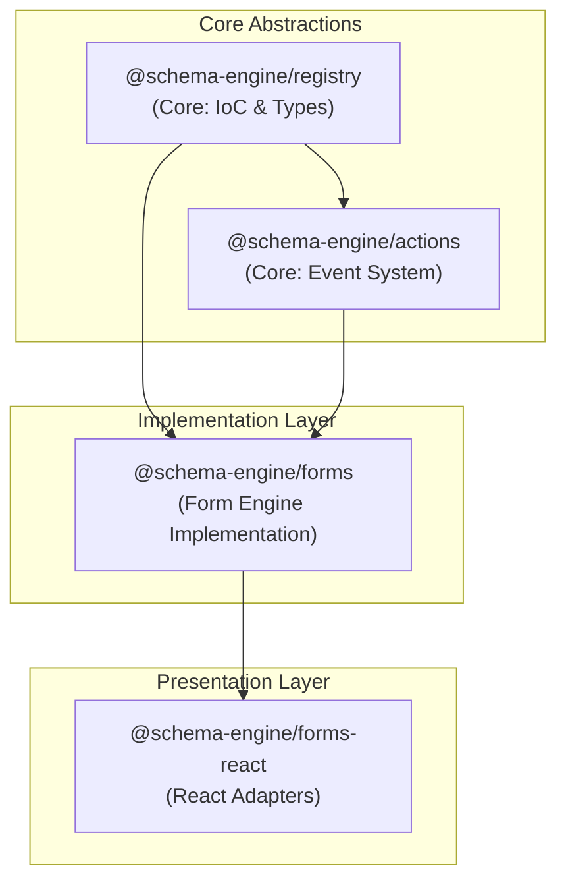

# Schema Engine

> **A Schema-First Foundation for Modular Interfaces** — Build deterministic, type-safe, and event-driven systems from portable definitions.

> **Important:** This README is an overview, not the API reference. For copy-paste-ready examples and current contracts, use the [Documentation App](./apps/docs) — start with [Quick Start](./apps/docs/src/content/docs/getting-started/quick-start.mdx).

---

Forms and renderer runtime diagnostics use package-tagged `@ecopages/logger`
instances. Debug output is disabled by default; warnings and errors remain visible.

## Why Schema Engine?

In modern software architecture, the layer between human intent and system behavior often remains a fragmented landscape of imperative logic and tightly coupled UI components.

**Schema Engine** establishes a new standard: **The Schema is the Single Source of Truth.**

While **Forms** are the most common application of this pattern, the same primitives can drive **Wizards**, **Dashboards**, **Kanban Boards**, and **Workflow Designers**. By treating interfaces as **structured capabilities** rather than just views, we enable a level of governance, velocity, and reliability that is impossible with ad-hoc component assembly.

---

## Core Concepts

We have distilled interface requirements into four core concepts that are completely domain-agnostic.

| Concept         | Role         | Description                                                                                 |
| --------------- | ------------ | ------------------------------------------------------------------------------------------- |
| **Registry**    | `Definition` | **IoC Container**. Decouples _what_ a component is from _how_ it renders (React, Vue, CLI). |
| **Action**      | `Behavior`   | **Command Pattern**. Handles system events and transitions state deterministically.         |
| **Constraint**  | `Logic`      | **Rule Engine**. Declarative rules that govern visibility and state without side effects.   |
| **Composition** | `Structure`  | **Recursive Assembly**. Builds complex systems from atomic, testable units.                 |

---

## Key Features by Example

### 1. End-to-End Type Fidelity

We reject the compromise between dynamic behavior and static analysis. Through advanced TypeScript inference, your runtime schema dictates your compile-time types.

```typescript
import { createFormEngine } from '@schema-engine/forms-react';
import { schemaFormRegistrations } from '@/components/schema-engine/forms/registrations';

const engine = createFormEngine({ elements: schemaFormRegistrations });
// Register schemaFormRecipeRegistrations when the form sets view.$type or has more than one step.

// Registered element types are inferred from createFormEngine options.
const myForm = {
	id: 'my-form',
	steps: [
		{
			id: 'step-1',
			elements: [
				{
					$type: 'input',
					name: 'username',
					label: 'Username',
					inputType: 'text',
					placeholder: 'Enter name',
				},
			],
		},
	],
};
```

### 2. Declarative Constraints

Complex logic (show/hide, enable/disable) typically leads to unmaintainable "spaghetti code" in UI components. We elevate this logic into **Constraints**—declarative rules evaluated by a central engine.

**Example: Conditional Visibility**
Show the "State" field only when "Country" is "US".

```typescript
{
  $type: 'select',
  name: 'country',
  label: 'Country',
  options: [{ label: 'United States', value: 'US' }, { label: 'Canada', value: 'CA' }]
},
{
  $type: 'select',
  name: 'state',
  label: 'State',
  // This field is hidden by default until the constraint is met
  constraints: [
    {
      field: 'country',
      operator: 'equals',
      value: 'US',
      action: 'show'
    }
  ]
}
```

### 3. Event-Driven Actions

Forms are dynamic systems. We model interactivity not as callbacks, but as discrete **Actions** triggered by events. This separates business logic from presentation.

**Example: Custom Submission Action**

```typescript
const submitLeadAction = {
	$type: 'submit_lead',
	schema: z.object({ endpoint: z.string() }),
	metadata: { name: 'Submit Lead' },
	execute: async (context) => {
		const result = await fetch(context.config.endpoint, {
			method: 'POST',
			body: JSON.stringify(context.formData),
		});
		return { success: result.ok };
	},
};

// Register with createFormEngine, then reference in form config actions array.
```

---

## System Architecture

The Schema Engine monorepo is organized as a layered architecture, moving from abstract definitions to concrete implementations.



---

## 📦 Packages

| Package                                                      | Version | Description                                                                                                                                                                                                                                                            |
| ------------------------------------------------------------ | ------- | ---------------------------------------------------------------------------------------------------------------------------------------------------------------------------------------------------------------------------------------------------------------------- |
| **[@schema-engine/forms](./packages/forms)**                 | `0.1.0` | Contains `createFormEngine` and `FormEngine`. Handles validation logic, constraint evaluation, and state management.                                                                                                                                                   |
| **[@schema-engine/forms-react](./packages/forms-react)**     | `0.1.0` | React Context bridge, hooks, adapters, full field-array operations, and rendering runtime. A new normalized config starts a fresh form instance; parent renders alone do not emit change events. Default view recipes live in the shadcn registry. |
| **[@schema-engine/forms-radiant](./packages/forms-radiant)** | `0.1.0` | Radiant/JSX adapter with hydrated registry validation, nested submit values, SSR constraints evaluated against defaults, authored disabled preservation, scoped form and engine controllers, optional decorators, array-level validation, initial row values, SSR default rows, and stable field-array row IDs. Binds canonical view recipes in-package; specs stay in `@schema-engine/forms/recipes`. |
| **[@schema-engine/actions](./packages/actions)**             | `0.1.0` | A standalone, domain-agnostic command pattern implementation for handling system events.                                                                                                                                                                               |
| **[@schema-engine/registry](./packages/registry)**           | `0.1.0` | The low-level type definitions and registry implementations that power the IoC container.                                                                                                                                                                              |

---

## 🚀 Quick Start

See the full walkthrough in [Quick Start](./apps/docs/src/content/docs/getting-started/quick-start.mdx). Minimal verified setup:

```bash
pnpm add @schema-engine/forms @schema-engine/forms-react react-hook-form zod
pnpm dlx shadcn@latest add andeeplus/schema-engine/schema-form andeeplus/schema-engine/schema-engine-form-recipes
```

```typescript
import { createFormEngine } from '@schema-engine/forms-react';
import { schemaFormRegistrations } from '@/components/schema-engine/forms/registrations';
import { schemaFormRecipeRegistrations } from '@/components/schema-engine/forms/recipes/registrations';

const engine = createFormEngine({
	elements: schemaFormRegistrations,
	recipes: schemaFormRecipeRegistrations,
});

const contactFormSchema = {
	id: 'contact-form',
	title: 'Contact Sales',
	view: { $type: 'card', shell: { padding: 'md' } },
	steps: [
		{
			id: 'step-1',
			elements: [
				{
					$type: 'input',
					name: 'company_name',
					label: 'Company Name',
					inputType: 'text',
					rules: [{ type: 'required' }],
				},
				{
					$type: 'input',
					name: 'business_email',
					label: 'Business Email',
					inputType: 'email',
					rules: [{ type: 'required' }, { type: 'email' }],
				},
			],
		},
	],
	actions: [{ $type: 'submit', id: 'submit_lead', endpoint: '/api/v1/leads' }],
};
```

```tsx
import { FormEngineProvider, FormRenderer } from '@schema-engine/forms-react';
import { rhfAdapter } from '@schema-engine/forms-react/adapters/react-hook-form';

export function ContactPage() {
	return (
		<FormEngineProvider engine={engine} adapter={rhfAdapter}>
			<FormRenderer config={contactFormSchema} onSubmit={(data) => console.log('Payload:', data)} />
		</FormEngineProvider>
	);
}
```

---

## 📚 Documentation

Detailed architectural documentation is available in the [Documentation App](./apps/docs).

- **[Quick Start](./apps/docs/src/content/docs/getting-started/quick-start.mdx)**
- **[Forms — Core Concepts](./apps/docs/src/content/docs/forms/core-concepts.mdx)**
- **[Component Registry](./apps/docs/src/content/docs/registry/overview.mdx)**
- **[Action System](./apps/docs/src/content/docs/actions/overview.mdx)**
- **[Forms React — Getting Started](./apps/docs/src/content/docs/forms-react/getting-started.mdx)**

---

## 📄 License

MIT © Schema Engine Contributors
