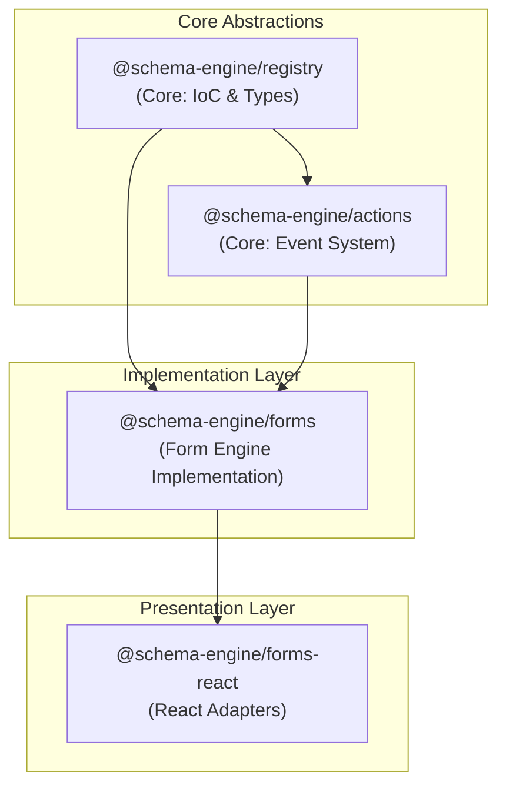

# Schema Engine

> **A Schema-First Foundation for Modular Interfaces** — Build deterministic, type-safe, and event-driven systems from portable definitions.

---

## Why Schema Engine?

In modern software architecture, the layer between human intent and system behavior often remains a fragmented landscape of imperative logic and tightly coupled UI components.

**Schema Engine** establishes a new standard: **The Schema is the Single Source of Truth.**

While **Forms** are the most common application of this pattern, the same primitives can drive **Wizards**, **Dashboards**, **Kanban Boards**, and **Workflow Designers**. By treating interfaces as **structured capabilities** rather than just views, we enable a level of governance, velocity, and reliability that is impossible with ad-hoc component assembly.

---

## Core Concepts

We have distilled interface requirements into four core concepts that are completely domain-agnostic.

| Concept         | Role         | Description                                                                                 |
| --------------- | ------------ | ------------------------------------------------------------------------------------------- |
| **Registry**    | `Definition` | **IoC Container**. Decouples _what_ a component is from _how_ it renders (React, Vue, CLI). |
| **Action**      | `Behavior`   | **Command Pattern**. Handles system events and transitions state deterministically.         |
| **Constraint**  | `Logic`      | **Rule Engine**. Declarative rules that govern visibility and state without side effects.   |
| **Composition** | `Structure`  | **Recursive Assembly**. Builds complex systems from atomic, testable units.                 |

---

## Key Features by Example

### 1. End-to-End Type Fidelity

We reject the compromise between dynamic behavior and static analysis. Through advanced TypeScript inference, your runtime schema dictates your compile-time types.

```typescript
// 1. Register components
const TextInput = {
	$type: 'text',
	schema: z.object({
		name: z.string(),
		label: z.string(),
		placeholder: z.string(),
	}),
	// ... metadata & render
};

// 2. Build the engine
const engine = new FormComposer().addElement(TextInput).build();

// 3. The Engine produces a strictly typed schema for your configurations
type FormConfig = z.infer<typeof engine.formConfigSchema>;

// Verified by TypeScript:
const myForm: FormConfig = {
	id: 'my-form',
	elements: [
		// ✅ Valid: 'text' is registered and matches the schema exactly
		{
			$type: 'text',
			name: 'username',
			label: 'Username',
			placeholder: 'Enter name',
		},

		// ❌ Error: 'email' is not registered
		// { $type: 'email', name: 'user_email' }
	],
};
```

### 2. Declarative Constraints

Complex logic (show/hide, enable/disable) typically leads to unmaintainable "spaghetti code" in UI components. We elevate this logic into **Constraints**—declarative rules evaluated by a central engine.

**Example: Conditional Visibility**
Show the "State" field only when "Country" is "US".

```typescript
{
  $type: 'select',
  name: 'country',
  label: 'Country',
  options: [{ label: 'United States', value: 'US' }, { label: 'Canada', value: 'CA' }]
},
{
  $type: 'select',
  name: 'state',
  label: 'State',
  // This field is hidden by default until the constraint is met
  constraints: [
    {
      field: 'country',
      operator: 'equals',
      value: 'US',
      action: 'show'
    }
  ]
}
```

### 3. Event-Driven Actions

Forms are dynamic systems. We model interactivity not as callbacks, but as discrete **Actions** triggered by events. This separates business logic from presentation.

**Example: Custom Submission Action**

```typescript
// Define a custom action
const submitLeadAction: ActionRegistration<'submit_lead'> = {
	$type: 'submit_lead',
	schema: z.object({ endpoint: z.string() }),
	metadata: { name: 'Submit Lead' },
	execute: async ({ context, config }) => {
		// 'context' contains the type-safe form data
		const result = await fetch(config.endpoint, {
			method: 'POST',
			body: JSON.stringify(context.formData),
		});

		return { success: result.ok };
	},
};

// Use it in your form
const formConfig = {
	/* ... elements ... */
	actions: [
		{
			$type: 'submit_lead',
			trigger: 'onSubmit',
			endpoint: '/api/v1/leads',
		},
	],
};
```

---

## System Architecture

The Schema Engine monorepo is organized as a layered architecture, moving from abstract definitions to concrete implementations.



---

## 📦 Packages

| Package                                                  | Version | Description                                                                                                          |
| -------------------------------------------------------- | ------- | -------------------------------------------------------------------------------------------------------------------- |
| **[@schema-engine/forms](./packages/forms)**             | `0.1.0` | Contains the `FormComposer` and `FormEngine`. Handles validation logic, constraint evaluation, and state management. |
| **[@schema-engine/forms-react](./packages/forms-react)** | `0.1.0` | Provides the React Context bridge, hooks, and default component libraries (Shadcn, Core UI).                         |
| **[@schema-engine/actions](./packages/actions)**         | `0.1.0` | A standalone, domain-agnostic command pattern implementation for handling system events.                             |
| **[@schema-engine/registry](./packages/registry)**       | `0.1.0` | The low-level type definitions and registry implementations that power the IoC container.                            |

### Schema library peers

Registrations use [Standard Schema](https://standardschema.dev/) (`~standard.validate`) as the portable contract. Built-in packages ship Zod schemas, but **Zod is a peer dependency** — install it in your app alongside the packages you use:

```bash
bun add zod @schema-engine/registry @schema-engine/forms @schema-engine/forms-react react-hook-form
```

You can also author registrations with Valibot, Effect Schema, or any other Standard Schema vendor.

---

## 🚀 Quick Start

Initialize a standard engine with best-practice defaults.

```bash
bun add @schema-engine/forms @schema-engine/forms-react zod react-hook-form
```

### 1. Compose the Engine

```typescript
import { FormComposer } from '@schema-engine/forms';
import { defaultShadcnRegistrations } from '@schema-engine/forms-react/registrations/default-shadcn';

// Create a deterministic engine instance
const engine = new FormComposer()
	.addElements(defaultShadcnRegistrations.elements)
	.addLayouts(defaultShadcnRegistrations.layouts)
	.addActions(defaultShadcnRegistrations.actions)
	.build();
```

### 2. Define the Schema

```typescript
const contactFormSchema = {
	id: 'contact-form',
	title: 'Contact Sales',
	elements: [
		{
			$type: 'text',
			name: 'company_name',
			label: 'Company Name',
			rules: [{ type: 'required' }],
		},
		{
			$type: 'email',
			name: 'business_email',
			label: 'Business Email',
			rules: [{ type: 'email' }, { type: 'business_domain' }],
		},
	],
	actions: [
		{
			$type: 'submit',
			id: 'submit_lead',
			endpoint: '/api/v1/leads',
		},
	],
};
```

### 3. Render

```tsx
import { FormEngineProvider, FormRenderer } from '@schema-engine/forms-react';

export function ContactPage() {
	return (
		<FormEngineProvider engine={engine}>
			<FormRenderer config={contactFormSchema} onSubmit={(data) => console.log('Payload:', data)} />
		</FormEngineProvider>
	);
}
```

---

## 📚 Documentation

Detailed architectural documentation is available in the [Documentation App](./apps/www).

- **[Core Concepts](./apps/www/src/pages/docs/core-concepts.mdx)**
- **[Component Registry](./apps/www/src/pages/docs/registry/index.mdx)**
- **[Action System](./apps/www/src/pages/docs/actions/index.mdx)**
- **[Constraint Logic](./apps/www/src/pages/docs/forms/constraints.mdx)**

---

## 📄 License

MIT © Schema Engine Contributors
