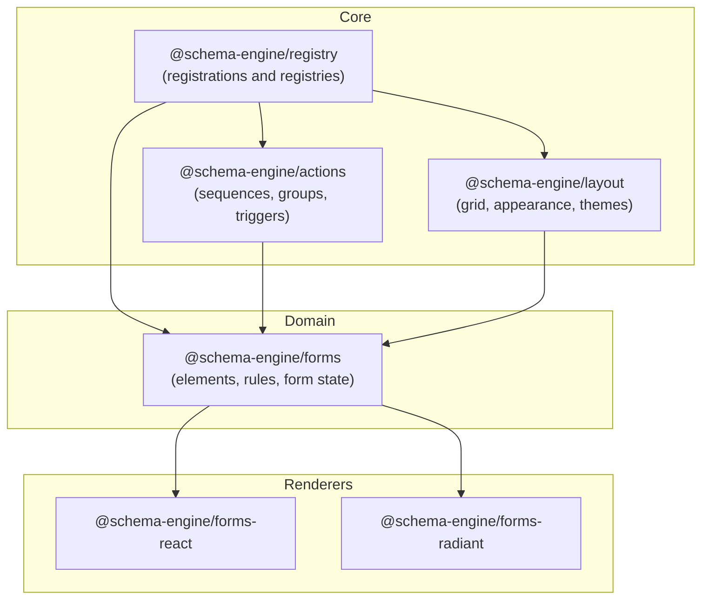

# Schema Engine

> **Declarative interfaces, extended with your own components and actions.**

Schema Engine is a common language for describing an interface or a process as data. You register the pieces it is made of, describe a screen or a workflow as a JSON document that names those pieces, and let a renderer draw it or an engine run it. The document can be written by hand, stored, or built on a server and sent to a client, and it stays the same data everywhere.

Start with the [documentation](./apps/docs/src/content/docs/schema-engine/introduction.mdx) or run the [quick start](./apps/docs/src/content/docs/schema-engine/quick-start.mdx).

---

## Why Schema Engine?

Schema Engine comes from years of building forms, and from seeing most of the ways to build them. Complex forms are hard to represent: fields that depend on other fields, steps that depend on earlier answers, checks that call a server, work that runs after a submit. After a lot of trial and error the result was a structure that holds them, and Schema Engine is that structure.

Two things mattered from the start. The person who builds with it owns the result: their inputs, their decorative elements, their design system. And it does not bend to a library or a framework. Schema Engine is not a component kit. It is a small set of rules, a common ground that anyone can use to describe their own interface and their own way of working, and that every renderer reads the same way.

**Forms** is the first domain, and the core is not limited to it. Schema Engine is not a standard. It uses [Standard Schema](https://standardschema.dev/) at the registration boundary, so a registration can be validated with Zod, Valibot, Effect Schema or a schema you write. [ABOUT.md](./ABOUT.md) describes the project's layers and how to talk about it.

---

## Core concepts

Four ideas carry everything else.

| Idea                     | What it is                                                                                                                                                                      | Read                                                                                        |
| ------------------------ | ------------------------------------------------------------------------------------------------------------------------------------------------------------------------------- | ------------------------------------------------------------------------------------------- |
| **Registry**             | A collection of registrations that follow the same rules. A registration has a `$type`, a schema for its configuration and metadata. A document names registrations by `$type`. | [Registry](./apps/docs/src/content/docs/registry/overview.mdx)                              |
| **Actions**              | Registered behaviour. An action entry in a document is data: its `$type`, its arguments and the triggers it answers. Entries run in order and a nested list runs in parallel.   | [Actions](./apps/docs/src/content/docs/actions/overview.mdx)                                |
| **Serialized documents** | A document holds only JSON, so a server can send an interface to a client and a client can check it, at the boundary, against the schemas of its registrations.                 | [Serialized documents](./apps/docs/src/content/docs/schema-engine/serialized-documents.mdx) |
| **Rendering from data**  | A renderer draws a validated document with the registrations of its engine. The rules for resolving, validating and dispatching live in the engine, not in the renderer.        | [Core concepts](./apps/docs/src/content/docs/schema-engine/core-concepts.mdx)               |

A workflow is a JSON array of action entries. `parseActions` checks each entry against its registration, and only what it returns can be dispatched:

```json
[
	{ "id": "reserve", "$type": "reserveStock", "sku": "tee-black-m", "quantity": 2 },
	[
		{ "id": "charge", "$type": "chargeCard", "amount": 120 },
		{ "id": "warehouse", "$type": "notifyWarehouse" }
	],
	{ "id": "receipt", "$type": "sendReceipt" }
]
```

The inner array is a group: its entries run together, and a failure with `shouldContinue: false` cancels the rest of the group. [A checkout workflow](./apps/docs/src/content/docs/examples/checkout-workflow.mdx) runs this one.

A form is a document too. Constraints are data: this field shows only when `country` is `US`.

```ts
{
	$type: 'select',
	id: 'state',
	name: 'state',
	label: 'State',
	options: [{ label: 'California', value: 'CA' }],
	constraints: [{ field: 'country', operator: 'equals', value: 'US', $type: 'show' }],
}
```

---

## System architecture

The monorepo has a core that knows no domain, the forms domain built on it, and two renderers.



---

## Packages

| Package                                                      | What it is                                                                                                                                                    |
| ------------------------------------------------------------ | ------------------------------------------------------------------------------------------------------------------------------------------------------------- |
| **[@schema-engine/registry](./packages/registry)**           | The registration contract and the registries that hold registrations by `$type`, with an optional YAML reader that reports errors by line and column.         |
| **[@schema-engine/actions](./packages/actions)**             | Registered behaviour that runs in sequences and parallel groups, answers triggers and cancels cooperatively. `parseActions` checks a workflow before it runs. |
| **[@schema-engine/layout](./packages/layout)**               | A grid with named placement and drawn areas, named appearance axes, and one compiled theme and stylesheet. It does not depend on forms.                       |
| **[@schema-engine/forms](./packages/forms)**                 | The forms domain: elements, validation rules, constraints, steps, the form state and the submit lifecycle, with no renderer.                                  |
| **[@schema-engine/forms-react](./packages/forms-react)**     | Renders a form with React. The form state hooks and primitives are for widgets you write, and ready-made fields are an optional shadcn registry.              |
| **[@schema-engine/forms-radiant](./packages/forms-radiant)** | Renders a form with Radiant. The elements and the view recipes ship in the package.                                                                           |

---

## Quick start

Each section of the docs starts with its installation and a quick start that runs:

- [Schema Engine](./apps/docs/src/content/docs/schema-engine/quick-start.mdx): a registry and a JSON workflow, with no UI.
- [Forms](./apps/docs/src/content/docs/forms/getting-started.mdx): a form checked and submitted with no renderer.
- [Forms React](./apps/docs/src/content/docs/forms-react/getting-started.mdx): a form with widgets of your own.
- [Forms Radiant](./apps/docs/src/content/docs/forms-radiant/getting-started.mdx): a form with the Radiant elements.

---

## Documentation

The [documentation app](./apps/docs) reads in this order:

- **[Introduction](./apps/docs/src/content/docs/schema-engine/introduction.mdx)** and **[Core concepts](./apps/docs/src/content/docs/schema-engine/core-concepts.mdx)**
- **[Registry](./apps/docs/src/content/docs/registry/overview.mdx)** and **[Actions](./apps/docs/src/content/docs/actions/overview.mdx)**
- **[Forms](./apps/docs/src/content/docs/forms/overview.mdx)**, **[Forms React](./apps/docs/src/content/docs/forms-react/overview.mdx)** and **[Forms Radiant](./apps/docs/src/content/docs/forms-radiant/overview.mdx)**
- **[Layout](./apps/docs/src/content/docs/layout/overview.mdx)**: grid, appearance axes and theming
- **[Examples](./apps/docs/src/content/docs/examples/overview.mdx)**: tested recipes with the files to copy
- **[shadcn registry sources](./registry/README.md)**: the optional React fields and recipes for Forms React
- **[Contributing](./CONTRIBUTING.md)**: the pre-commit hook and how to run its checks locally

---

## License

MIT © Schema Engine Contributors
